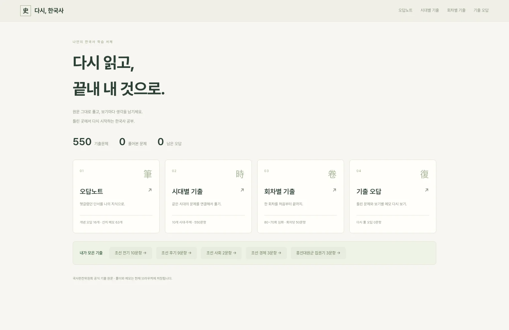
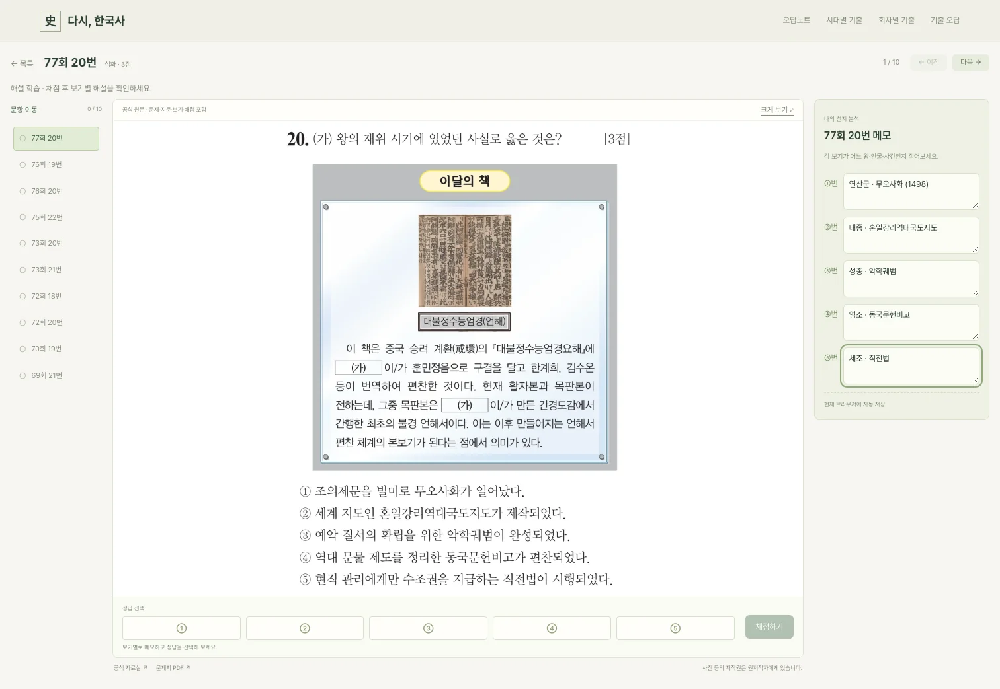
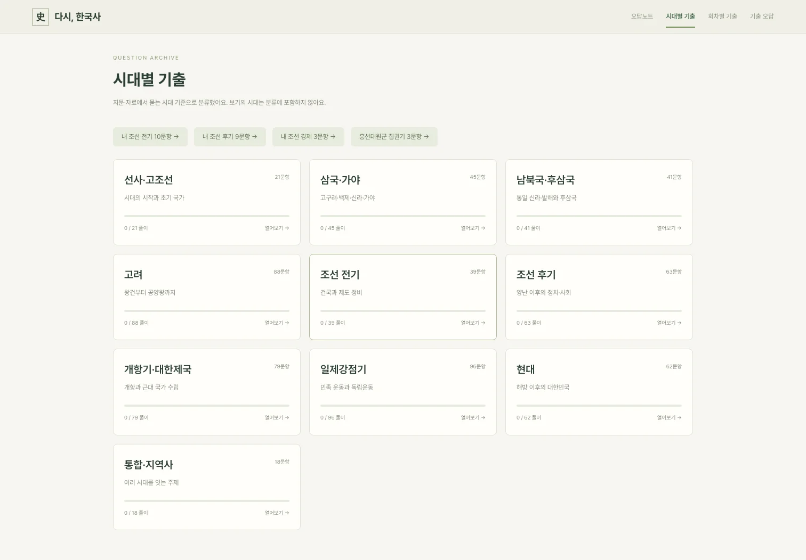

<div align="center">

# 史 다시, 한국사

**원문 그대로 풀고, 보기마다 생각을 남기다.**

기출 원문과 보기별 메모로 복습하는 한국사 학습 웹앱


**11개 회차 · 550문항 · ①~⑤ 선지별 메모**

[화면 미리보기](#화면-미리보기) · [학습 기능](#학습-기능) · [시작하기](#시작하기) · [Vercel 배포](#vercel-배포)

</div>

---

틀린 문제에서 다시 시작하는 한국사 공부를 위해 만들었습니다. 한국사능력검정시험 심화 **80~70회**를 원문 이미지로 풀고, 각 보기가 어느 왕·인물·사건을 가리키는지 직접 적으며 복습합니다.

## 화면 미리보기

### 나만의 학습 서재

오답노트, 시대별 기출, 회차별 기출, 기출 오답을 한곳에서 시작합니다.



### 원문 풀이와 선지별 메모

지문·자료·보기·배점을 그대로 보면서, 오른쪽 메모장에 ①~⑤를 정리합니다.



<details>
<summary><strong>시대별 기출 화면 펼쳐보기</strong></summary>

문제의 지문과 자료에서 묻는 시대를 기준으로 모았습니다. 보기 속 다른 시대는 분류에 포함하지 않습니다.



</details>

## 학습 기능

| 메뉴 | 할 수 있는 일 |
| :--- | :--- |
| **오답노트** | 헷갈린 개념에 직접 답을 쓰고 채점하기 · 기존 선지 메모 복습 |
| **시대별 기출** | 같은 시대의 문제 이어 풀기 · 채점 후 등록된 보기별 해설 확인 |
| **회차별 기출** | 한 회차 50문항 풀기 · 해설 학습 / 실전 시험 선택 |
| **기출 오답** | 틀린 문제를 정답이 가려진 상태로 다시 풀기 · 다시 맞히면 목록에서 제외 |

- **공식 원문 보존** — 문제·지문·사진·보기·배점을 문항 이미지로 제공하고 공식 문제지·정답표를 연결합니다.
- **선지별 생각 기록** — ①~⑤ 메모를 문제마다 독립적으로 저장합니다. 재도전해도 메모는 유지됩니다.
- **전체 원문 보기** — 화면 크기에 맞춰 문제 전체를 표시하는 확대 화면을 제공합니다.
- **브라우저 자동 저장** — 풀이 기록과 메모를 localStorage에 보관합니다.

### 해설 학습과 실전 시험

| | 해설 학습 | 실전 시험 |
| :--- | :--- | :--- |
| 진입 | 시대별·회차별 기출, 개인 복습 | 회차별 기출에서 선택 |
| 채점 | 문제마다 채점 | 전체 답안 작성 후 일괄 제출 |
| 정답·해설 | 채점 후 확인 | 제출 전에는 숨김 |
| 제출 후 | 보기별 해설과 내 메모 복습 | 총점 확인 후 해설 복습으로 이동 |

> **해설 현황** · 개인 복습 31문항에 보기별 설명이 등록되어 있습니다. 나머지 기출의 보기별 해설은 아직 작성 중이며, 미등록 문항에는 해당 상태를 표시합니다.

### 내가 모은 기출

| 복습 묶음 | 문항 수 | 주요 내용 |
| :--- | ---: | :--- |
| 조선 전기 | 10 | 왕의 정책, 사화, 인물과 편찬물 |
| 조선 후기 | 9 | 붕당 정치, 양난, 농민 봉기 |
| 조선 사회 | 2 | 관청의 기능, 후기 사회·문화 |
| 조선 경제 | 3 | 농업·상업·광업, 대동법과 균역법 |
| 흥선대원군 집권기 | 3 | 병인양요, 신미양요, 경복궁 중건 |
| 006_근대적 개혁 추진(개항~갑신정변) | 4 | 개항기 조약, 관세, 조약 사이의 사건 |

기존 개인 복습의 **69회 21번**은 정규 550문항과 별도로 유지합니다.

## 시작하기

Node.js **24**를 권장합니다. 버전은 `.nvmrc`에 지정되어 있습니다.

```sh
npm ci
npm run dev
```

접속 주소: **http://127.0.0.1:8765/**

| 명령 | 설명 |
| :--- | :--- |
| `npm run dev` | 로컬 개발 서버 실행 |
| `npm test` | 데이터 검증과 풀이 흐름 테스트 |
| `npm run check:fsd` | 계층 의존 방향과 슬라이스 공개 API 검사 |
| `npm run build` | TypeScript 검사 및 배포 빌드 |
| `npm run preview` | 빌드 결과 로컬 확인 — 개발 서버 종료 후 실행 |

> 풀이 기록은 **같은 브라우저·같은 주소**에서 유지됩니다. 로컬 주소와 배포 주소, 다른 기기 사이에는 자동 동기화되지 않습니다.

## 프로젝트 구조

React + TypeScript를 기반으로 **FSD** 계층을 적용했습니다. 스타일은 Tailwind CSS, 글꼴은 자체 호스팅 **Pretendard Variable**을 사용합니다.

```text
src/
├── app/          앱 진입점과 라우팅
├── pages/        학습 서재 · 기출 목록 · 풀이 · 오답노트
├── widgets/      공통 사이트 헤더
├── features/     답안 채점 · 실전 답안 · 보기별 메모 · 개념 복습
├── entities/     문제 · 시대 · 오답노트 데이터와 타입
└── shared/       브라우저 저장소 · 공통 스타일

public/           배포할 원문 문항 이미지
scripts/          공식 PDF 수집 · 문항 추출 · 분류 · 메모 병합
tests/            데이터와 사용자 흐름 검증
docs/images/      README용 화면 캡처 — 앱 배포 산출물에 미포함
```

의존 방향은 `app → pages → widgets → features → entities → shared`이며, 다른 슬라이스는 `index.ts` 공개 API로 가져옵니다.

<details>
<summary><strong>문항 데이터 관리</strong></summary>

| 파일 | 역할 |
| :--- | :--- |
| `src/entities/question/data/questions.json` | 문항, 정답, 배점, 시대, 출처, 개인 메모 |
| `src/entities/study-note/data/` | 직접 답을 쓰는 개념 오답노트 |
| `scripts/fetch-exams.py` | 공식 PDF 다운로드 |
| `scripts/build-question-bank.py` | PDF 문항 추출 · 스캔본 OCR |
| `scripts/finalize-question-bank.py` | 시대 분류와 개인 복습 데이터 병합 |
| `scripts/era-classification.json` | 문항 시대 분류 규칙 |
| `scripts/personal-choice-explanations.json` | 개인 복습 보기별 설명 |
| `scripts/joseon-economy-review.json` | 조선 경제 복습 데이터 |
| `scripts/daewongun-review.json` | 흥선대원군 집권기 복습 데이터 |
| `scripts/modern-reforms-review.json` | 근대적 개혁 추진 복습 데이터 |

원본 PDF와 중간 파일은 `tmp/`에 보관하며 Git·배포 대상에서 제외합니다. 데이터 재생성에는 PDF 처리용 Python 환경과 macOS Vision OCR 도구가 필요합니다.

문항 이미지는 `public/questions/`의 WebP를 사용하며, 현재 열어 본 문제의 이미지를 불러옵니다. 전체 550장을 처음부터 내려받지 않습니다.

</details>

## Vercel 배포

**GitHub 저장소를 Vercel에 가져오는 방식**을 권장합니다. 운영 브랜치를 `main`으로 설정하면 push·merge 시 자동 배포되고, 다른 브랜치에서는 미리보기 배포를 확인할 수 있습니다. [Vercel Git 연동 문서](https://vercel.com/docs/git)

| 설정 | 값 |
| :--- | :--- |
| Root Directory | 이 프로젝트 폴더 |
| Framework Preset | **Vite** |
| Install Command | `npm ci` |
| Build Command | `npm run build` |
| Output Directory | `dist` |
| Node.js | **24.x** |

`vercel.json`에 빌드 설정과 SPA 경로 재작성을 구성했습니다. `/eras`, `/exams` 등 하위 경로를 직접 열거나 새로고침할 수 있습니다. 환경 변수나 외부 DB는 필요하지 않습니다.

<details>
<summary><strong>CLI로 배포하기</strong></summary>

```sh
npm i -g vercel@latest
vercel
```

미리보기 확인 후 운영 배포:

```sh
vercel --prod
```

</details>

## 자료 출처

기출문제와 정답은 **[국사편찬위원회 한국사능력검정시험](https://www.historyexam.go.kr/)**의 공식 자료를 바탕으로 합니다. 문항별 공식 문제지·정답표 링크는 풀이 화면에서 확인할 수 있습니다. 문제지·사진·지도 등 자료의 권리는 각 권리자에게 있습니다.

<details>
<summary><strong>해설 작성 참고 자료</strong></summary>

- [조선의 정치 기구](https://contents.history.go.kr/eh_kk/teach/tong/III/16.htm)
- [동학과 영해 봉기](https://contents.history.go.kr/mobile/tg/view.do?ganada=&levelId=tg_004_0090&pageUnit=10&subjectCode=all&tabId=02)
- [신해통공](https://contents.history.go.kr/mobile/kc/view.do?code=kc_age_30&levelId=kc_i304000)
- [경복궁 중건](https://contents.history.go.kr/mobile/kc/view.do?levelId=kc_r300200)
- [보은 집회](https://contents.history.go.kr/front/tg/print.do?levelId=tg_004_0400&treeId=&whereStr=)
- [청일 전쟁](https://contents.history.go.kr/front/nh/view.do?levelId=nh_040_0010)
- [한청 통상 조약(1899)](https://sillok.history.go.kr/popup/print.do?gubun=kor&id=kza_13609011_004)
- [조일 통상 장정](https://contents.history.go.kr/front/hm/view.do?levelId=hm_115_0040)
- [미쓰야 협정](https://contents.history.go.kr/front/hm/view.do?levelId=hm_125_0140)
- [제1차 한일 협약](https://contents.history.go.kr/front/hm/view.do?levelId=hm_121_0150)
- [청의 내정 간섭](https://contents.history.go.kr/mobile/kc/view.do?code=kc_age_40&levelId=kc_i403200)

</details>
